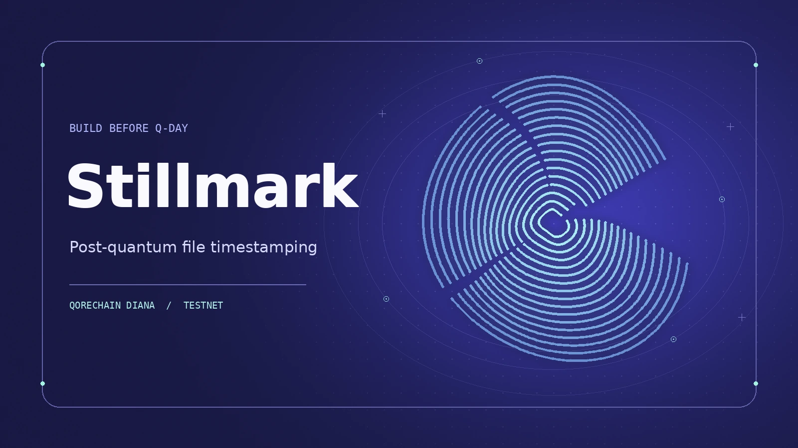

# Stillmark



Stillmark timestamps a file fingerprint on QoreChain Diana. Select a local file, approve a hybrid-signed transaction in QoreX, and share the transaction hash. Anyone with the same file can compare its SHA-256 digest against the committed fingerprint. A receipt records which testnet address anchored those bytes and when the transaction was included.

**Build Before Q-Day · Post-Quantum dApp.** The [event rules](https://build.qorechain.io/rules) list a deadline of December 2, 2026 at 23:59 UTC and note that the rules and dates may change.

## Run from a fresh clone

Install Node.js 22.18+ and npm. The app uses free Diana testnet QOR for transactions.

```sh
git clone https://github.com/ZQ051031/qorechain-devfest.git
cd qorechain-devfest
npm ci
npm test
npm run build
npm run dev
```

Open **http://localhost:5173**. No environment file is required. For a local preview of the production build, run `npm run preview` and open the URL Vite prints. Vite proxies the three Diana read routes for both modes because the public endpoints omit browser CORS headers.

## Create and verify a stamp

1. Open the app with the current [QoreX extension](https://qorechain.io/qorex) enabled. Set QoreX to **Testnet** and select a native account with a `qor1…` address.
2. Click **Connect QoreX** and approve the connection. Copy the address from Stillmark, open **Free test QOR**, and request the free Diana allocation to that address. The [official faucet](https://dashboard.qorechain.io/faucet) requires sign-in. Return to Stillmark and click the balance to refresh it. If the faucet reports a cooldown, use an existing free testnet balance or wait for the next claim.
3. Choose a non-sensitive file of up to 64 MiB. Stillmark hashes its bytes locally. The file name and bytes stay on your device. The fingerprint will be public and can be compared with anyone's copy of a candidate file.
4. Click **Sign and stamp**. In QoreX, review the **0.001 test QOR self-transfer**, the network fee, and the memo if the wallet displays it. Approve on **Diana Testnet**. The transfer returns to the same address and the fee uses test QOR.
5. Wait for **Hybrid signature verified** and **Selected file matches this stamp**. Copy the transaction hash and signer address. If the hash appears before indexing, click **Verify receipt** to retry the read. Open **Diana explorer** and select **Testnet** in the explorer's network menu.
6. To reproduce the check without a wallet, open a new tab, paste the hash into **Verify a receipt**, and select the same file. Changing a byte in a second copy produces a mismatch.

**Public verification example.** Click **Look up public example** or run `npm run verify:diana`. Both verify a successful native hybrid self-transfer from Diana block **10547679**. This public transaction predates Stillmark's first stamp and has no Stillmark memo.

- Transaction hash `C9C675AF8A17FF8F783FBB8CDCD5EA768462E240F57750F0D8CA5E15F0104E39`
- Public example signer `qor1ff44amgm07w2nrfuk6u25kfu8tlprdm2yj52dp`
- [Explorer](https://explore.qore.network/tx/C9C675AF8A17FF8F783FBB8CDCD5EA768462E240F57750F0D8CA5E15F0104E39) · [Diana RPC response](https://rpc-testnet.qore.host/tx?hash=0xC9C675AF8A17FF8F783FBB8CDCD5EA768462E240F57750F0D8CA5E15F0104E39)

**Entry evidence pending wallet approval.** Once you create a Stillmark stamp, record its transaction hash, explorer link, and native signer address for the entry. Use the signer of the Stillmark stamp as the project address. To verify your stamp from the terminal as well, run:

```sh
npm run verify:diana -- YOUR_TRANSACTION_HASH path/to/original-file
```

The command returns the chain ID, block height and time, signer, fingerprint, and comparison result. It exits nonzero on a missing receipt, an unverified hybrid signature, or a file mismatch.

## How it works

- **Wallet approval.** Stillmark starts with the official `fullstack-web` Vite + React + TypeScript template from `create-qorechain-dapp@0.14.0`. The read proxy uses the Diana network preset from `@qorechain/sdk`, and the app sends the native `MsgSend` request using `@qorechain/qorex-types`. QoreX holds the signing keys and constructs and broadcasts the secp256k1 + ML-DSA-87 transaction.
- **Fingerprint format.** The tx memo is `stillmark:v1:sha256:<64 lowercase hex characters>`. The app only recognizes a Stillmark stamp if its verified signer sent exactly 1,000 `uqor` to the same address in a single native bank message.
- **Chain verification.** The reader recomputes the transaction hash over the raw committed bytes, checks the block's `qorechain-diana` chain ID, and requires successful execution, one classical secp256k1 signature, one critical hybrid extension, and a `pqc_hybrid_verify` event with status `verified`. Diana calls its ML-DSA-87 algorithm `dilithium5` in this event. Verification trusts the configured public Diana RPC for the block header and execution result.
- **Network.** Diana's EVM chain ID is `9800`. Stillmark uses the native lane, where QoreX attaches the ML-DSA-87 signature to each stamp transaction.

## Submission assets

- [Featured image](public/cover.webp) · 1600 × 900 WebP
- [Recording script](docs/demo-video.md) · 2 minutes 40 seconds
- [MIT licence](LICENSE)

The [QoreChain SDK scaffold](https://github.com/qorechain/qorechain-sdk/tree/main/templates/fullstack-web) is by QoreChain and is distributed under [Apache 2.0](docs/upstream-apache-2.0.txt). Stillmark's original code and artwork use MIT.
